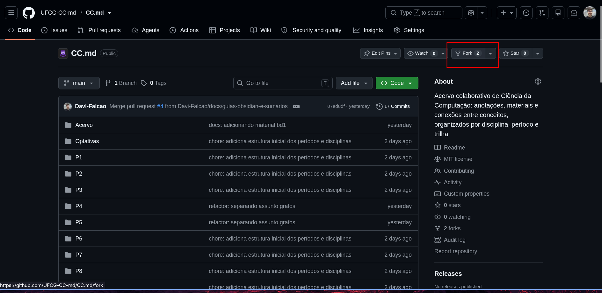
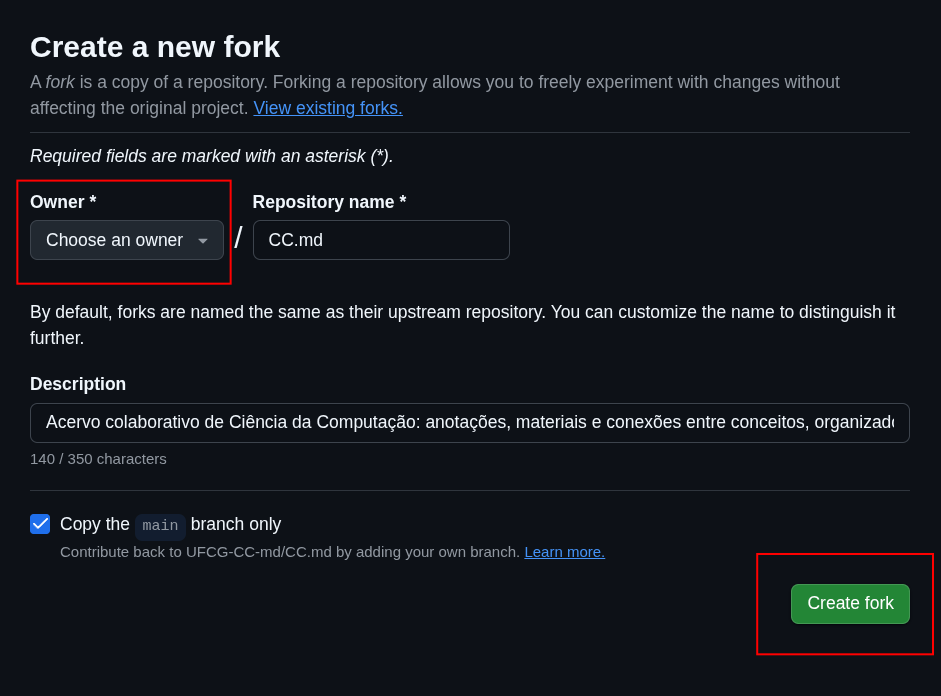
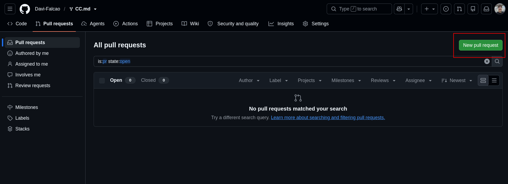
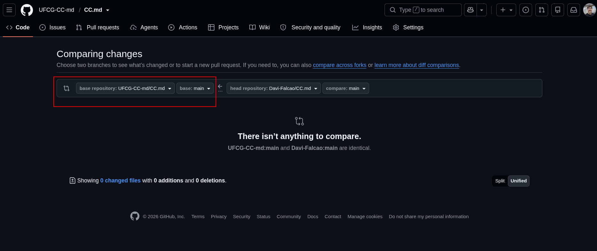
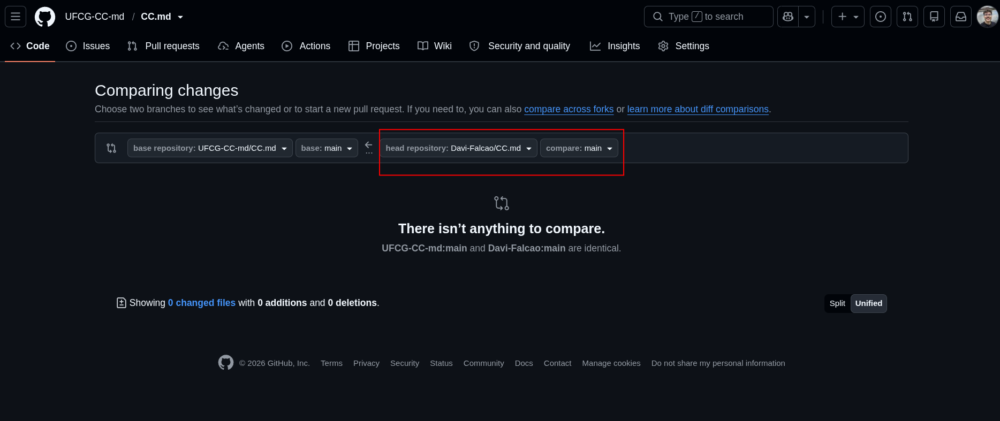

# Usando Git no CC.md

O Git guarda o histórico das mudanças e ajuda a compartilhar suas anotações. Você pode editar as notas no Obsidian ou em qualquer editor e usar os comandos abaixo pelo terminal.

Se quiser apenas ler o acervo, não precisa usar Git: o [guia do Obsidian](GUIA-OBSIDIAN.md) explica como baixar o ZIP e abrir a pasta.

## 1. Instalar o Git

Escolha o comando correspondente à sua distribuição.

### Debian, Ubuntu, Linux Mint e derivados

```bash
sudo apt update
sudo apt install git
```

### Fedora e derivados

```bash
sudo dnf install git
```

### Arch Linux, Manjaro e derivados

```bash
sudo pacman -Syu git
```

No Windows e no macOS, consulte as [opções de instalação do Git](https://git-scm.com/downloads). No Windows, você pode executar os comandos deste guia pelo Git Bash.

## 2. Clonar o repositório

Clonar é baixar o projeto junto com seu histórico. No terminal, entre na pasta em que deseja guardar o acervo e escolha **uma** das opções abaixo.

### Para acompanhar o acervo

```bash
git clone https://github.com/UFCG-CC-md/CC.md.git
cd CC.md
```

### Para enviar contribuições

Para contribuir, o caminho é: **criar seu fork → clonar o fork → editar e enviar as mudanças para ele → abrir uma PR para o projeto principal**. O fork é sua cópia do repositório no GitHub; o clone é a cópia que fica no seu computador.

#### Criar o fork

Entre na sua conta do GitHub e abra a [página do projeto](https://github.com/UFCG-CC-md/CC.md). Confira o nome no topo: **`UFCG-CC-md / CC.md`** é o repositório principal, onde fica o acervo compartilhado. Clique em **Fork**, no canto superior direito.



Na tela **Create a new fork**:

1. Em **Owner**, selecione sua conta pessoal.
2. Mantenha **Repository name** como `CC.md` para acompanhar os exemplos deste guia.
3. Pode deixar **Copy the main branch only** marcado: basta copiar a branch principal para começar.
4. Clique em **Create fork**.



#### Acessar sua cópia

Depois da criação, o GitHub abre seu fork. Confira o nome no topo: agora deve aparecer **`SEU_USUARIO / CC.md`**, e não `UFCG-CC-md / CC.md`. A indicação de que ele é um fork do projeto original ajuda a identificar essa relação.

Para voltar a ele depois, acesse `https://github.com/SEU_USUARIO/CC.md` ou clique na sua foto de perfil no GitHub, entre em **Your repositories** e procure `CC.md`. Substitua `SEU_USUARIO` pelo seu usuário real. Nas imagens deste guia, `Davi-Falcao/CC.md` é apenas o fork usado como exemplo; o seu ficará na sua conta.

**As mudanças da sua contribuição devem ser feitas no seu fork**, não diretamente no repositório principal. Neste guia, você vai editar a cópia local do fork e publicar os commits nele com `git push`. Só depois abrirá uma *pull request* (PR), que é um pedido para incorporar essas mudanças ao acervo compartilhado.

#### Clonar o fork no computador

Na página **do seu fork**, clique em **Code → HTTPS** e copie a URL. Ela deve conter seu usuário, como no comando abaixo:

```bash
git clone https://github.com/SEU_USUARIO/CC.md.git
cd CC.md
```

Execute o clone apenas uma vez, na pasta onde deseja guardar o acervo. Se já clonou seu fork, basta abrir a pasta existente. Para conferir a qual repositório essa cópia está ligada:

```bash
git remote -v
```

As URLs de `origin` devem apontar para **`SEU_USUARIO/CC.md`**. É para esse endereço que o `git push` enviará sua contribuição. Se aparecer `UFCG-CC-md/CC.md`, você clonou o principal, não seu fork; se ainda não fez alterações, clone seu fork em outra pasta para seguir este tutorial sem misturar as cópias. Se já começou a escrever, preserve os arquivos antes de trocar de pasta.

O clone cria a pasta oculta `.git` dentro de `CC.md/`. Ela guarda o histórico e as configurações locais do Git: **não é preciso adicioná-la manualmente ao Obsidian**, nem movê-la para outro cofre. O ZIP do GitHub não inclui esse histórico; para usar os comandos deste guia, faça o clone.

Com o projeto no computador, siga o [guia do Obsidian a partir da abertura do acervo](GUIA-OBSIDIAN.md#2-baixar-e-abrir-o-acervo) se quiser usar o aplicativo.

## 3. Configurar a autoria dos commits

Antes do primeiro commit, informe seu nome e e-mail:

```bash
git config --global user.name "Seu Nome"
git config --global user.email "seu-email@example.com"
```

Esses dados ficam nos commits. Use o e-mail privado (*noreply*) disponível nas configurações de e-mail do GitHub se não quiser expor o pessoal. A opção `--global` vale para todos os seus repositórios; se já usa Git, confira sua configuração antes de trocá-la.

## 4. Criar uma branch e salvar uma anotação

Dentro da pasta `CC.md/` do seu fork, crie uma branch antes de editar:

```bash
git switch -c nota-busca-em-largura
```

A branch separa essa contribuição das outras mudanças. Escolha um nome relacionado ao que você vai escrever. No Obsidian ou no editor, abra **essa mesma pasta clonada do seu fork**: editar outra cópia do acervo não altera os arquivos desta branch.

Crie ou edite a nota, por exemplo `P5/IA/Busca em largura.md`, seguindo o [guia de contribuição](CONTRIBUTING.md). Depois, no terminal:

```bash
git status
git diff
git add "P5/IA/Busca em largura.md"
git diff --cached
git commit -m "docs: adiciona anotação sobre busca em largura"
git push -u origin nota-busca-em-largura
```

- `git status` mostra arquivos novos e modificados.
- `git diff` mostra as alterações ainda não selecionadas em arquivos que o Git já acompanha; abra os arquivos novos no editor para conferir o conteúdo.
- `git add` seleciona a nota indicada para o commit. Se você também alterou o sumário da disciplina ou adicionou imagens, selecione esses arquivos pelo caminho.
- `git diff --cached` mostra exatamente o que entrará no commit.
- `git commit` registra a mudança localmente.
- `git push` publica a branch no seu fork.

Não use `git add .` sem conferir os arquivos: configurações pessoais do Obsidian (como `.obsidian/`) ou outros arquivos locais podem entrar no commit.

Para enviar via HTTPS, talvez seja necessário autenticar com o GitHub CLI, um gerenciador de credenciais ou um token. A senha da conta do GitHub não funciona como senha do `git push`; nunca coloque tokens nas notas ou nos commits.

Depois do `git push`, os commits estão no seu fork no GitHub. **Isso ainda não altera o repositório principal**: falta abrir a PR e aguardar a revisão.

## 5. Abrir uma pull request para o CC.md

### Entrar na tela de comparação

No navegador, volte ao seu fork em `https://github.com/SEU_USUARIO/CC.md`. Depois de enviar a branch, o GitHub pode mostrar um aviso com o botão **Compare & pull request**. Se ele aparecer, clique nele.

Se o aviso não aparecer, abra a aba **Pull requests** do seu fork e clique em **New pull request**, como na imagem.



### Conferir o destino: o repositório principal

Na tela **Comparing changes**, o lado esquerdo indica **para onde** você quer enviar a contribuição:

- **base repository:** `UFCG-CC-md/CC.md`, o repositório principal.
- **base:** `main`, a branch principal que receberá as mudanças.

Confira esses dois campos antes de continuar. Se a base estiver no seu próprio fork, você estará propondo uma mudança dentro dele, não para o acervo compartilhado. Se os seletores de repositório não aparecerem, clique em **compare across forks**.



### Selecionar a origem: sua branch no fork

O lado direito indica **de onde** vêm as mudanças:

- **head repository:** `SEU_USUARIO/CC.md`, o seu fork.
- **compare:** a branch em que você fez os commits e que enviou com `git push`. No exemplo deste guia, `nota-busca-em-largura`.



Na captura, o fork de exemplo é `Davi-Falcao/CC.md` e o campo **compare** está em `main`. Para acompanhar os comandos deste guia, troque esse campo para **`nota-busca-em-largura`** no seu fork. Se a branch não aparecer, confira se o `git push` terminou sem erros e se você selecionou o fork correto.

A mensagem **There isn’t anything to compare**, mostrada nas imagens, significa que as branches selecionadas estão idênticas. Não é a confirmação de envio de uma PR. Verifique se escolheu a branch com sua contribuição e se publicou os commits; apenas editar e salvar a nota no computador não a envia ao GitHub.

Antes de avançar, a comparação deve representar este caminho:

**`SEU_USUARIO/CC.md:nota-busca-em-largura` → `UFCG-CC-md/CC.md:main`**

### Conferir os arquivos e enviar a PR

Com a origem e o destino corretos, confira a lista de commits e as diferenças dos arquivos na parte de baixo da página. Devem aparecer apenas as mudanças da sua contribuição, incluindo o sumário ou as imagens quando necessário, sem configurações pessoais.

Clique em **Create pull request**. Dê um título que resuma a contribuição, como “Adiciona anotação sobre busca em largura”, e escreva uma descrição curta dizendo:

- O que você adicionou ou corrigiu.
- Em qual disciplina ou pasta estão as mudanças.
- Como conferiu o conteúdo, os links e as fontes, quando houver.

Se aparecer um modelo de descrição do projeto, siga as orientações dele. Depois, confirme em **Create pull request** para abrir o pedido de revisão.

A PR fica no repositório principal, na aba [Pull requests](https://github.com/UFCG-CC-md/CC.md/pulls). Abrir o pedido não incorpora as mudanças automaticamente: quem mantém o projeto vai revisar e pode pedir ajustes antes de aceitar.

Se precisar corrigir algo, edite os arquivos **na mesma branch local do seu fork**, selecione as mudanças, faça outro commit e execute `git push`. A PR aberta será atualizada com esses commits; não precisa criar outro fork nem outra PR para os ajustes da mesma contribuição.

## 6. Receber atualizações

Antes de atualizar, execute `git status`. Se houver alterações locais, termine e registre seu trabalho em um commit antes de continuar.

Se você clonou diretamente o repositório principal e não tem alterações locais pendentes, execute na branch principal:

```bash
git pull --ff-only
```

Se você clonou um **fork**, o `origin` aponta para sua cópia, não para o projeto principal. Para trazer novidades do CC.md, abra seu fork no GitHub, use **Sync fork → Update branch** e depois execute `git pull --ff-only` na branch principal local correspondente.

O `--ff-only` interrompe a atualização se os históricos tiverem divergido, em vez de criar uma mesclagem automaticamente. Se isso acontecer ou o Git indicar conflitos, confira as mudanças antes de continuar; não apague arquivos nem descarte seu trabalho só para fazer o comando passar.
