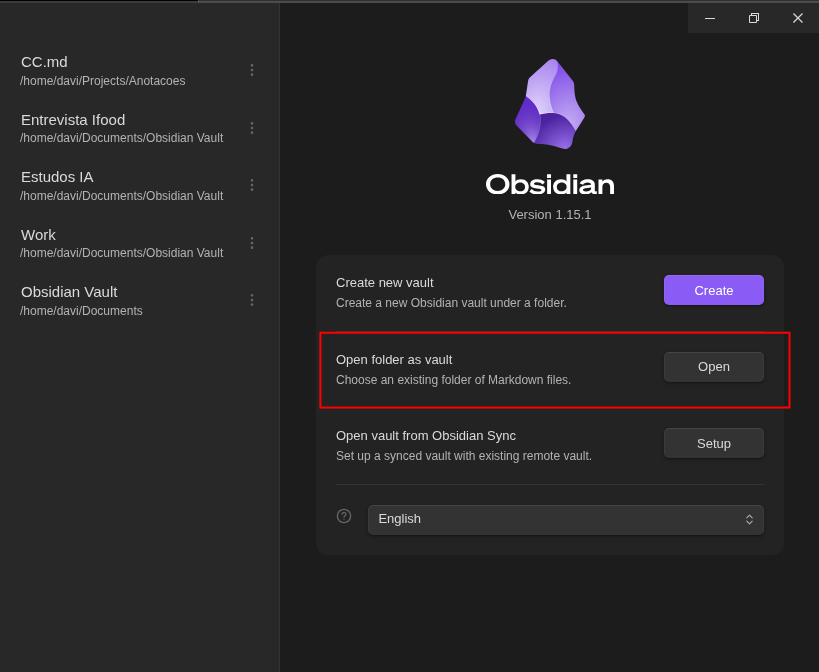
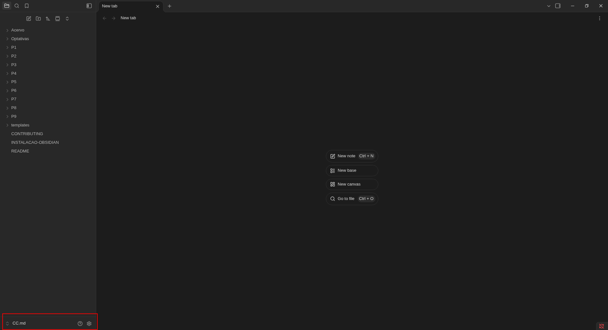
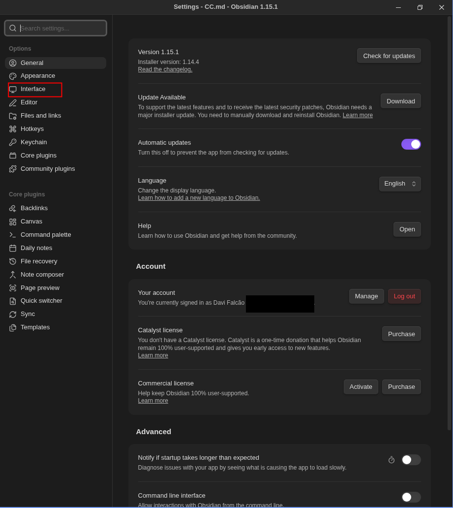
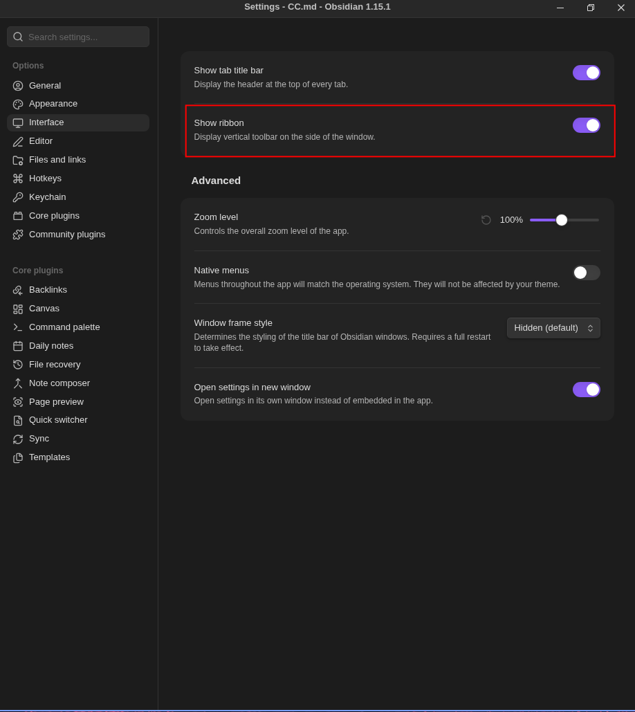
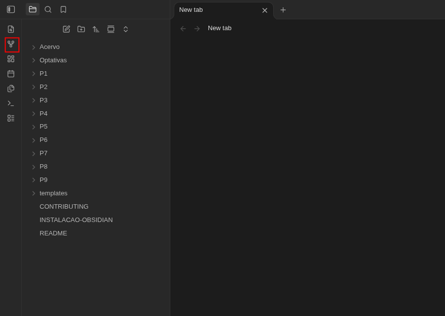

# Primeiros passos com o CC.md no Obsidian

O Obsidian abre uma pasta de arquivos Markdown como um **cofre** (*vault*). Aqui, o cofre é a pasta `CC.md` inteira: os períodos, as disciplinas e as notas continuam sendo arquivos comuns. O aplicativo é opcional, mas ajuda a navegar pelas conexões entre os assuntos.

## 1. Instalar o Obsidian

A [página oficial de downloads](https://obsidian.md/download) tem versões para Linux, Windows, macOS, Android e iOS. No **Windows e no macOS, baixe o instalador do seu sistema e siga as instruções de instalação.**

**No Linux,** escolha **uma** das opções abaixo, conforme sua distribuição. Não é preciso executar todas.

### Debian, Ubuntu, Linux Mint e derivados

Baixe o pacote `.deb` para sua arquitetura na página oficial. Abra o terminal na pasta em que salvou o arquivo e execute:

```bash
sudo apt install ./obsidian_*.deb
```

O `./` é importante: instala o arquivo baixado, não um pacote chamado `obsidian` dos repositórios. Confira o nome do arquivo caso ele seja diferente.

### Arch Linux, Manjaro e derivados

Se o pacote estiver disponível nos repositórios configurados da sua distribuição:

```bash
sudo pacman -Syu obsidian
```

### Fedora e outras distribuições com Flatpak

Com o Flatpak instalado e o Flathub configurado, você pode usar o [pacote mantido pela comunidade](https://flathub.org/apps/md.obsidian.Obsidian):

```bash
flatpak install flathub md.obsidian.Obsidian
```

Essa opção também serve para Ubuntu, Mint e outras distribuições que tenham Flatpak e Flathub.

### Distribuições com Snap

Se o Snap já estiver disponível no seu sistema:

```bash
sudo snap install obsidian --classic
```

No Mint, o Snap pode estar desativado por padrão; prefira o `.deb` ou o Flatpak se não quiser habilitá-lo.

### Outras distribuições Linux: AppImage

Baixe o AppImage para sua arquitetura na página oficial. Na pasta do arquivo, permita sua execução e abra o aplicativo:

```bash
chmod +x ./Obsidian-*.AppImage
./Obsidian-*.AppImage
```

Os nomes dos arquivos podem mudar com as atualizações. Ajuste o comando ao nome baixado e mantenha apenas um AppImage correspondente nessa pasta. Se um gerenciador de pacotes não estiver instalado ou configurado, use outra opção compatível com seu sistema.

## 2. Baixar e abrir o acervo

Para apenas ler e explorar as notas, abra a [página do CC.md no GitHub](https://github.com/UFCG-CC-md/CC.md), clique em **Code → Download ZIP** e extraia o arquivo. A pasta extraída pode se chamar `CC.md-main`: o importante é que ela contenha `README.md`, `P1/` e as demais pastas do projeto.

Se quiser receber atualizações e enviar contribuições com Git, siga a parte de clonagem do [guia de Git](GUIA-GIT.md) e depois volte aqui. Se você já tem um cofre pessoal, mantenha-o separado do acervo.

Abra o Obsidian e escolha **Abrir pasta como cofre** (*Open folder as vault*), clicando em **Open**, como na imagem. Não é preciso criar um cofre vazio nem usar o Obsidian Sync.



Selecione a pasta `CC.md` que você clonou ou a pasta extraída do ZIP e confirme. **Não selecione `P1/`, `.git/` ou apenas uma disciplina**: a raiz do projeto é o cofre que reúne todo o acervo. Se já estiver em outro cofre, use o seletor de cofres para voltar à tela de abertura.

Com o acervo aberto, as pastas aparecem à esquerda. Abra um período (`P1/` a `P9/`) ou `Optativas/`, entre na disciplina e procure o sumário com o nome da matéria. Algumas pastas ainda estão vazias: o acervo está em construção.

## 3. Ativar o menu lateral

O Obsidian tem uma barra de arquivos e uma faixa vertical de ícones, chamada *ribbon*. É nessa faixa que fica o atalho para o grafo. Se ela não aparecer, dá para ativá-la pelas configurações.

As capturas estão em inglês; os nomes podem variar conforme o idioma e a versão do aplicativo.

Primeiro, clique na **engrenagem** no canto inferior esquerdo, ao lado do nome do cofre.



Nas configurações, selecione **Interface** no menu à esquerda. A imagem abaixo destaca a opção que você deve abrir.



Dentro de **Interface**, ative **Show ribbon** (mostrar a faixa de opções). Na imagem, o botão roxo indica que ela já está ativada.



Depois, feche as configurações. A faixa de ícones deve aparecer na extremidade esquerda, ao lado da lista de arquivos.

## 4. Visualizar o grafo

Clique no ícone de **pontos conectados**, destacado na imagem, para abrir a **Visualização de grafo** (*Graph view*).



Se o ícone não aparecer mesmo com a faixa ativada, confira em **Configurações → Plugins nativos** (*Core plugins*) se **Visualização de grafo** (*Graph view*) está habilitada. Não é preciso instalar plugins da comunidade.

No grafo, os pontos representam notas e as linhas representam links entre elas. Pastas e propriedades, sozinhas, não criam essas linhas. Você pode aproximar a visualização com a rolagem do mouse e clicar em um ponto para abrir a nota.

Para encontrar um assunto diretamente, use a busca pelo nome ou pelo texto. As propriedades também ajudam: tente `[periodo: 5]`, `[disciplina: IA]` ou `[trilhas: Infra]`.

## 5. Criar um link entre notas

Imagine que você está escrevendo uma explicação e quer apontar para outra nota do acervo. No editor, digite `[[` e comece a escrever o nome da nota de destino. O Obsidian mostra sugestões: selecione a nota desejada para completar o link, como `[[Busca em largura]]`.

Coloque o link em uma frase que explique a relação entre os assuntos, não só em uma lista de termos. Você pode escrever, por exemplo: “Para percorrer os vértices por camadas, usamos a [[Busca em largura]].” Use esse exemplo quando a nota de destino já existir no acervo.

Se quiser mudar apenas o texto que aparece na frase, use uma barra vertical: `[[Busca em largura|busca por camadas]]`. O destino continua sendo a mesma nota. Se houver arquivos com nomes repetidos, inclua o caminho: `[[P5/IA/Busca em largura]]`.

Depois de sair da edição do link, clique nele no modo de leitura para abrir a nota. No modo de edição, use `Ctrl` + clique (`Cmd` + clique no macOS). Essa ligação também aparece no grafo.

Antes de criar uma nota nova, confira se o conceito já existe com outro nome. Um link para uma nota inexistente não substitui a explicação: escreva o conteúdo e conecte-o às notas relacionadas.

Para começar sua contribuição, copie o [modelo de nota](templates/Nota.md) para a pasta da disciplina e preencha as propriedades do início do arquivo. Inclua a nota no sumário da matéria; se ainda não houver um, use o [modelo de sumário](templates/Sumario%20da%20disciplina.md). O [guia de contribuição](CONTRIBUTING.md) explica o padrão das notas, e o [guia de Git](GUIA-GIT.md) mostra como enviar seu trabalho.

## Quer ver mais?

- [Ajuda oficial do Obsidian](https://help.obsidian.md/) — documentação sobre cofres, notas, links e grafo.
- [Tutorial em vídeo sobre o Obsidian](https://youtu.be/64qkBzaGnIw?si=It14TuE97oT8q0Ab) — para acompanhar os primeiros passos em vídeo; use as orientações acima para abrir especificamente o acervo `CC.md`.
